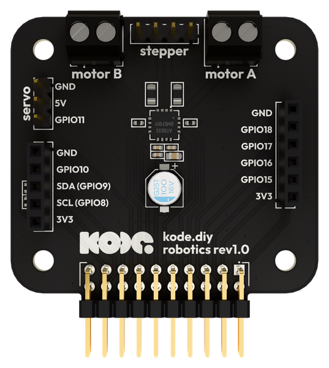

<div align="center" markdown="1">



# kode-robotics-sdk

**The SDK for the Robotics module of the Kode Dot: motors, a stepper, a servo and switched outputs from an app, in C**

[](https://github.com/espressif/esp-idf)


[Documentation](https://docs.kode.diy/modules/robotics) ·
[Quick start](#quick-start) ·
[Examples](#examples) ·
[kode-sdk](https://github.com/kodediy/kode-sdk)

</div>

---

The Robotics (KDROB001) is a motor module for the **Kode Dot**. It plugs into the expansion header (J3) and carries an AT8833 dual H-bridge, a servo connector, and two small connectors with the header's free lines and its I2C pair. This SDK sits next to [kode-sdk](https://github.com/kodediy/kode-sdk): an app adds one dependency and calls `robotics_motor_drive()`, `robotics_stepper_move()` or `robotics_servo_angle()`, and does not need to know the pins, the bridge's truth table or the PWM's timers.

- **One owner for the module.** One Active Object finds the module, upright or turned round, and is the only code that drives it; your code asks it. It notices when the module is pulled out, and when it comes back.
- **Two layers, as in kode-sdk.** `robotics.h` has calls that wait, for `app_main()` and your tasks: each answers `true` or `false`, and `robotics_error()` says why. `robotics_sys.h` has calls that never wait, for an Active Object of your own.
- **Nothing moves by itself.** The SDK moves nothing until the app asks: not when the module comes back, not when the board wakes. A call that cannot be done says so and changes nothing; no value is ever cut to fit.

```c
#include "kode.h"
#include "robotics.h"

void app_main(void)
{
    robotics_begin();                             /* starts the board too */
    robotics_watchdog_set(5000);                  /* everything off if the app goes quiet for 5 s */
    while (!robotics_wait_present(5000)) {
        kode_print("no Robotics on J3 yet");      /* the module's supply may take a while */
    }
    if (!robotics_motor_drive(ROBOTICS_MOTOR_A, 60)) {    /* forward at 60 %, along the ramp */
        kode_print("%s", robotics_error());
    }
    kode_delay(3000);
    robotics_stop();                              /* everything off */
    kode_exit();                                  /* back to kodeOS */
}
```

## Quick start

You need a Kode Dot running kodeOS, a Robotics module on its expansion header and [ESP-IDF v6.1](https://docs.espressif.com/projects/esp-idf/en/v6.1/esp32p4/get-started/).

```bash
. <path-to-esp-idf>/export.sh
idf.py -C examples/module build
idf.py -C examples/module -p PORT flash
```

The first build prints one CMake error while it fetches the board settings, `kbsp: the partition table has no apps region (data, 0x40), so this app has nowhere to be installed`, and goes on by itself. `flash` writes the app to the board's mailbox; kodeOS installs it and starts it. The log says that the module was found, which way round it sits and what the SDK knows of it. Pull the module out and the log says so. `module` drives nothing, so the computer's USB port is enough for it: run it first. The examples that drive something want the Dot on a USB-C charger (5 V, 3 A) once they are flashed. Hold the bottom button for 3 s to go back to kodeOS. Read [Safety](docs/overview.md#safety) before you wire a motor.

To start an app of your own, copy the example closest to it.

## Examples

| | |
|---|---|
| `module` | the module found on the header, which way round, and its status. Drives nothing: run it first |
| `motors` | two DC motors: a tone, then forward, reverse, brake and coast |
| `stepper` | a bipolar stepper, by moves and by speed |
| `servos` | the servo on J402, to an angle and at a speed |
| `outputs` | the two bridges as four switched outputs with their own PWM |
| `i2c` | the I2C pair: scanned by the SDK, then lent to the app for a bus of its own |
| `console_actions` | the module on kodeOS's console |

`module`, `motors` and `stepper` are tasks (`robotics.h`); the other four are Active Objects (`robotics_sys.h`). No example moves anything until a person presses the top button or types a row, and every one sets the watchdog.

## Use it in your project

```yaml
# main/idf_component.yml
dependencies:
  kodediy/kode:
    git: https://github.com/kodediy/kode-sdk.git
    path: components/kode
    version: v0.1.5
  kodediy/robotics:                  # or kodediy/robotics_sys, for an app with Active Objects
    git: https://github.com/kodediy/kode-robotics-sdk.git
    path: components/robotics        # or components/robotics_sys
    version: v0.1.0
```

Add `robotics` (or `robotics_sys`) to your component's `REQUIRES`. Copy `CMakeLists.txt` and `sdkconfig.defaults` from an example: they fetch the Dot's settings from kode-sdk, and they set `CONFIG_KODEOS_RADIO=y`, which lets the SDK switch the module's supply.

## Not run on a module yet

This release builds for the ESP32-P4 and passes its host tests, but it has not been run on a module yet. Try it first with nothing attached that could be damaged, and take most care with the stepper, the four outputs and the fault latch.

## Documentation

Everything else is at **[docs.kode.diy/modules/robotics](https://docs.kode.diy/modules/robotics)**. In this repository, [the overview](docs/overview.md) says how to use the module safely, what the SDK drives, how it works, what surprises, the options, the console, what it costs an app and the layout of the tree. The two headers, `robotics.h` and `robotics_sys.h`, are the contract: every call's comment says what it does and what it refuses. Each component and each example also has a short README.

## Contributing

Bugs, ideas and pull requests are welcome. Read [CONTRIBUTING.md](CONTRIBUTING.md) first. Pull requests go to `develop`, and its maintainer approves each one, and the checks a change must pass are `tools/host_tests.sh`, `tools/check_layers.sh`, `tools/check_example_pins.sh` and `idf.py -C tests/target build`, run on your machine.

## Licence

[GPL-3.0-or-later](LICENSE), as kode-sdk. [NOTICE.md](NOTICE.md) says which licence applies where.
